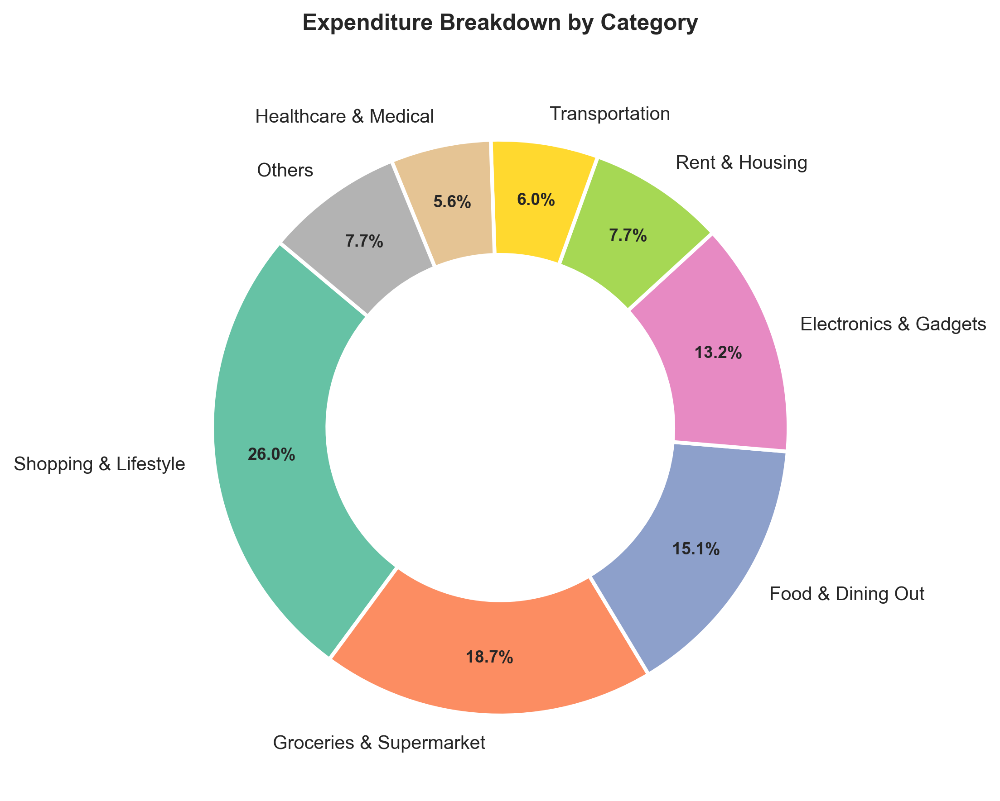
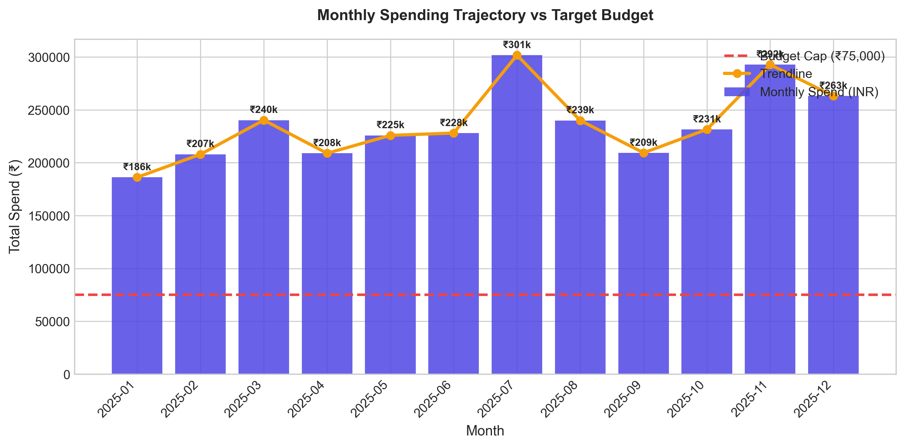
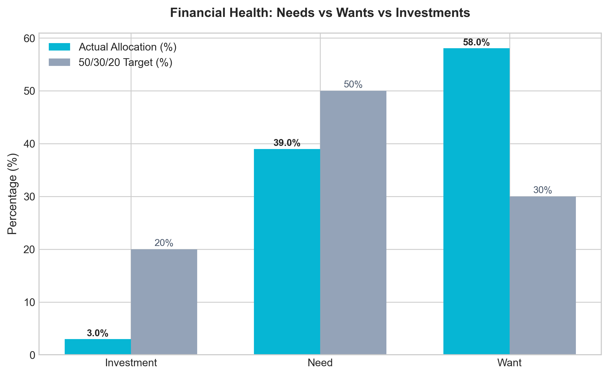
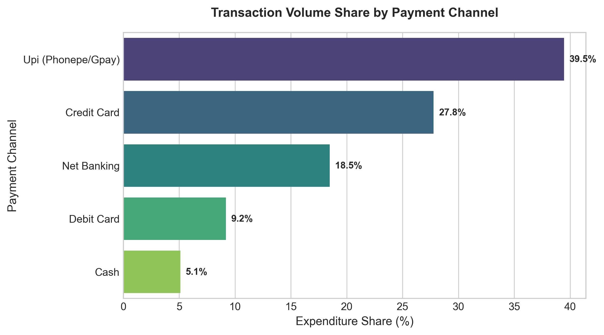
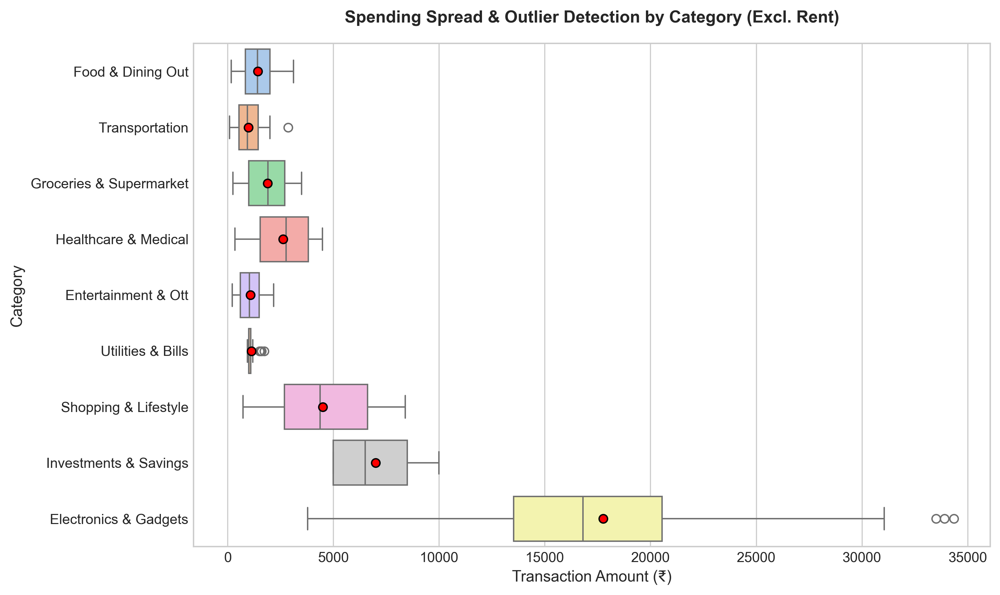

# 💳 FinTrack Pro: Expense Tracker App using Data Science

[](https://www.python.org/)
[](https://streamlit.io/)
[](https://pandas.pydata.org/)
[](https://plotly.com/)
[](https://scikit-learn.org/)
[](LICENSE)

An **industry-grade, interactive personal finance analytics and budgeting application** built with Python, Data Science, and Machine Learning. Designed for **Data Analyst, Business Analyst, and Financial Analyst** roles to demonstrate competencies in ETL data pipelines, statistical exploratory analysis, the 50/30/20 budgeting rule, anomaly detection, predictive forecasting, and executive dashboard design.

---

## 📌 1. Project Overview & Business Value

Managing personal cash flows and business expenditures is critical for long-term solvency. However, most individuals struggle with:
- **Invisible Cash Leakage**: Unmonitored discretionary micro-transactions ("Wants") compounding over months.
- **Lack of Predictive Foresight**: Only realizing an overspend after a credit card statement or bank alert arrives.
- **Disorganized Data Silos**: Fragmented transactions across UPI (GPay/PhonePe), Credit Cards, Net Banking, and Cash.

### The Solution: FinTrack Pro
**FinTrack Pro** bridges this gap by offering:
1. **Automated ETL & Feature Engineering**: Standardizes multi-channel transactions, parsing dates, weekends, categories, and payment methods.
2. **50/30/20 Budgeting Audit**: Evaluates outgoing capital against the institutional 50% (Needs), 30% (Wants), and 20% (Savings/Investments) allocation framework.
3. **Statistical Anomaly Detection**: Employs Interquartile Range (IQR) filtering to spotlight impulse purchases and unusual spending spikes.
4. **Predictive Outflow Forecasting**: Leverages time-series trend regression with 90% confidence bounds to estimate next month's total spend and calculate budget breach probability.
5. **Interactive Executive Web UI**: Built with Streamlit and Plotly for real-time transaction logging, dynamic date filtering, and one-click audit report downloads.

---

## 🏗️ 2. Project Architecture

```
┌───────────────────────┐     ┌────────────────────────┐     ┌────────────────────────┐
│     DATA INGESTION    │     │       PROCESSING       │     │     ANALYTICS & ML     │
│                       │     │                        │     │                        │
│ • Synthetic Generator │ ──> │ • Schema Validation    │ ──> │ • Financial KPIs       │
│ • Manual Live Entry   │     │ • Temporal Feature Eng │     │ • 50/30/20 Rule Audit  │
│ • Multi-Channel Pay   │     │ • Cumulative Running   │     │ • Statistical IQR      │
│   (UPI/Card/NetBank)  │     │   Spend Calculation    │     │ • Ridge Regression ML  │
└───────────────────────┘     └────────────────────────┘     └────────────────────────┘
                                                                          │
                                                                          ▼
┌─────────────────────────────────────────────────────────────────────────────────────┐
│                             CONSUMPTION & INTERFACES                                │
│                                                                                     │
│  ┌──────────────────────────────┐        ┌──────────────────────────────────────┐   │
│  │   Interactive Web Dashboard  │        │       Automated Static Assets        │   │
│  │   (Streamlit + Plotly)       │        │   (Matplotlib + Seaborn + TXT)       │   │
│  │  • KPI Metric Cards          │        │  • Category Donut Chart              │   │
│  │  • Sunburst Deep Drilldown   │        │  • MoM Spending Trendline            │   │
│  │  • Real-Time Expense Form    │        │  • Need vs Want Allocation Chart     │   │
│  │  • Budget Overrun Alerts     │        │  • Outliers Boxplot                  │   │
│  │  • CSV & TXT Export          │        │  • Executive Audit Report (TXT)      │   │
│  └──────────────────────────────┘        └──────────────────────────────────────┘   │
└─────────────────────────────────────────────────────────────────────────────────────┘
```

---

## 📂 3. Repository Structure

```
Expense-Tracker-App/
│
├── data/                                 # Storage for raw and cleaned financial data
│   ├── expenses_dataset.csv              # Synthetic multi-channel raw transactions
│   └── processed_expenses.csv            # Feature-engineered dataset
│
├── notebooks/                            # Exploratory Data Analysis & Notebooks
│   └── Expense_Analysis_EDA.ipynb        # In-depth statistical analysis & EDA
│
├── src/                                  # Core modular pipeline source code
│   ├── data_generator.py                 # Realistic synthetic personal finance generator
│   ├── data_processor.py                 # Schema validation, missing value imputation, feature engineering
│   ├── analytics.py                      # Financial KPIs, 50/30/20 audit, IQR anomaly detection
│   ├── ml_predictor.py                   # Ridge regression spend forecasting & overrun probability
│   └── visualizer.py                     # High-resolution Matplotlib/Seaborn visualization engine
│
├── outputs/                              # Automated analysis outputs & reports
│   ├── category_spending_donut.png       # Publication-ready donut chart
│   ├── monthly_spending_trend.png        # Monthly expenditure vs budget ceiling
│   ├── need_vs_want_split.png            # Actual vs Benchmark budget adherence
│   ├── payment_mode_distribution.png     # Channel volume share
│   ├── category_outliers_boxplot.png     # Outlier boxplot across categories
│   └── executive_summary.txt             # Plain English executive briefing
│
├── images/                               # Copy of visual assets for README display
│   ├── category_spending_donut.png
│   ├── monthly_spending_trend.png
│   ├── need_vs_want_split.png
│   ├── payment_mode_distribution.png
│   └── category_outliers_boxplot.png
│
├── app.py                                # Full-featured Streamlit interactive web dashboard
├── main.py                               # CLI pipeline orchestrator
├── requirements.txt                      # Project dependencies
├── .gitignore                            # Production git exclusions
└── README.md                             # Comprehensive project documentation
```

---

## ⚙️ 4. Installation & Quick Start

### Prerequisites
- Python 3.9, 3.10, 3.11, 3.12, or 3.13 installed.
- Git installed.

### Step 1: Clone Repository
```bash
git clone https://github.com/your-username/Expense-Tracker-App.git
cd Expense-Tracker-App
```

### Step 2: Set Up Virtual Environment (Recommended)
**Windows (PowerShell):**
```powershell
python -m venv venv
.\venv\Scripts\Activate.ps1
```

**macOS / Linux:**
```bash
python3 -m venv venv
source venv/bin/activate
```

### Step 3: Install Dependencies
```bash
pip install -r requirements.txt
```

### Step 4: Execute Full Pipeline (CLI Mode)
Runs data generation, processing, analytics, ML model, generates static charts, and creates an executive brief:
```bash
python main.py
```

### Step 5: Launch Interactive Web Dashboard
```bash
streamlit run app.py
```
Open your browser at `http://localhost:8501`.

---

## 📊 5. Visual Insights & Analytical Proof

### 1. Category-Wise Outflow Composition
Identifies primary expense drivers and where capital is allocated across the portfolio.


### 2. Monthly Spending Trajectory vs Budget Ceiling
Tracks month-on-month velocity with dynamic benchmark comparison.


### 3. Financial Health: 50/30/20 Rule Adherence
Audits actual cash flows against the institutional guideline (50% Needs, 30% Wants, 20% Investments).


### 4. Payment Mode Channel Distribution
Analyzes customer preferences across UPI, Credit Cards, Net Banking, and Cash.


### 5. Category Outliers & Dispersion (Boxplots)
Statistical detection of anomalous high-value transactions.


---

## 🤖 6. Machine Learning Methodology

### Model: Time-Trend Regularized Ridge Regression
- **Target Variable**: Monthly Total Outflow ($y_t$).
- **Features**: Temporal progression index ($t$), rolling moving average lag features ($SMA_3$).
- **Uncertainty Quantification**: 90% prediction intervals calculated via in-sample residual standard error:
  $$\hat{y}_{t+1} \pm 1.645 \times \sigma_{\epsilon}$$
- **Budget Overrun Risk Probability**: Evaluates normal cumulative distribution function $P(Y > \text{Budget})$ to trigger proactive alerts before fiscal overspending occurs.

---

## 💼 7. Interview Talking Points (Data / Business / Financial Analyst)

1. **How do you handle realistic synthetic financial data without access to bank APIs?**
   - *Answer*: Structured a generative simulator using log-normal distributions, realistic day-of-month recurring commitments (Rent on 1st, Utilities on 5th, SIP on 10th), and weekend discretionary spending multipliers (1.25x) reflecting behavioral consumer finance trends.
2. **How is the 50/30/20 financial rule applied programmatically?**
   - *Answer*: Mapped transaction categories to behavioral classifications (`Need`, `Want`, `Investment`). Calculated variance between actual allocations and institutional targets to provide prescriptive savings recommendations.
3. **How are anomalies identified without hardcoded thresholds?**
   - *Answer*: Implemented the nonparametric Interquartile Range (IQR) technique per category. Transactions exceeding $Q_3 + (1.5 \times \text{IQR})$ are flagged as discretionary outliers, isolating rare luxury purchases from regular recurring expenses.
4. **Why choose Ridge Regression over complex deep learning for this time series?**
   - *Answer*: With monthly aggregated financial data, sample sizes are compact ($N \approx 12-36$ months). Complex deep neural networks easily overfit. Ridge regression with $L_2$ shrinkage provides low-variance, interpretable trend forecasting with robust confidence intervals.

---

## 🔮 8. Future Enhancements
- [ ] Automated bank statement PDF/CSV parser with OCR.
- [ ] Multi-currency conversion via live Forex APIs.
- [ ] Automated WhatsApp/Email overspending push notifications.
- [ ] Credit score simulator and debt payoff optimizer (Avalanche & Snowball methods).

---

## 📄 License
This project is open-source and available under the [MIT License](LICENSE).
